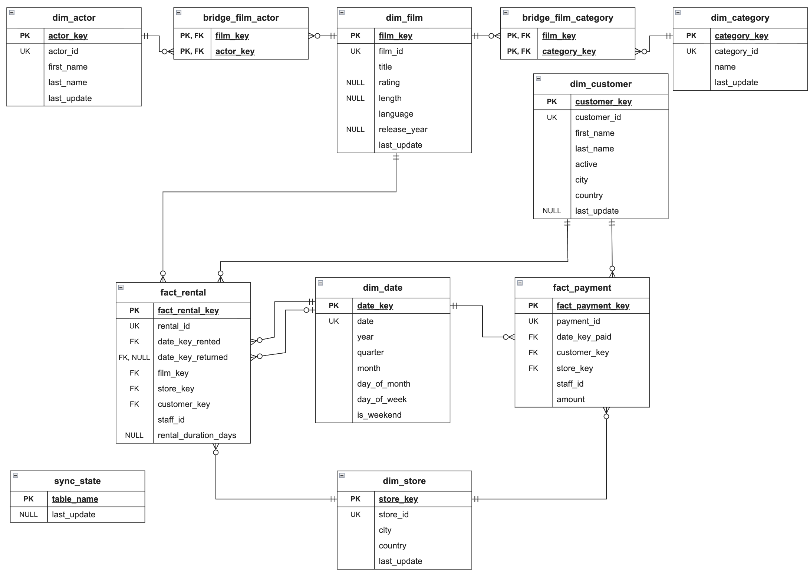

## Setup

The project uses Python **3.9.6** and SQLAlchemy **2.0.57**, with PyMySQL **1.2.3**, python-dotenv **1.2.1**, and pytest **8.4.2**. 

Load `sakila-schema.sql` and then `sakila-data.sql` into MySQL using the official Sakila installation instructions. From the repository root, create a virtual environment and install the dependencies:

```bash
python3 -m venv .venv
source .venv/bin/activate
python -m pip install -r requirements.txt
```

Set the following environment variables, or put them in a local `.env` file:

```dotenv
MYSQL_HOST=127.0.0.1
MYSQL_PORT=3306
MYSQL_USER=your_mysql_user
MYSQL_PASSWORD=your_mysql_password
MYSQL_DATABASE=sakila
SQLITE_PATH=analytics.db
MYSQL_TEST_DATABASE=sakila_test
```

## Commands

Run the commands from the repository root with the virtual environment active:

```bash
python main.py init
python main.py full-load
python main.py incremental
python main.py validate
python main.py validate --from YYYY-MM-DD --to YYYY-MM-DD
```

## Run the tests

Run all tests:

```bash
python -m pytest -v -s tests
```

Run tests individually:

```bash
python -m pytest -v -s tests/test_init.py
python -m pytest -v -s tests/test_full_load.py
python -m pytest -v -s tests/test_incremental_new.py
python -m pytest -v -s tests/test_incremental_updates.py
python -m pytest -v -s tests/test_validate.py
```

## Analytics ER diagram



## Indexes

The SQLite models declare single-column indexes with `index=True`.

### Unique indexes

Each column below uses `unique=True, index=True` to look up existing rows during synchronization and enforce uniqueness.

- `dim_actor.actor_id` finds the actor row for a Sakila actor ID.
- `dim_category.category_id` finds the category row for a Sakila category ID.
- `dim_customer.customer_id` finds the customer row for a Sakila customer ID.
- `dim_film.film_id` finds the film row for a Sakila film ID.
- `dim_store.store_id` finds the store row for a Sakila store ID.
- `fact_payment.payment_id` finds the payment row for a Sakila payment ID.
- `fact_rental.rental_id` finds the rental row for a Sakila rental ID.

### Non-unique indexes

- `fact_payment.customer_key` supports payment lookups and joins by customer.
- `fact_payment.date_key_paid` supports filtering payments by date range in `validate`.
- `fact_payment.store_key` supports the store join used to compare payment totals by store.
- `fact_rental.customer_key` supports rental lookups and joins by customer.
- `fact_rental.date_key_rented` supports filtering rentals by date range in `validate`.
- `fact_rental.date_key_returned` supports joins to `dim_date` by return date.
- `fact_rental.film_key` supports rental lookups and joins by film.
- `fact_rental.store_key` supports rental lookups and joins by store.

### Indexes created Automately

- `dim_date.date` uses `unique=True` to enforce one row per calendar date.
- `bridge_film_actor (film_key, actor_key)` uses a composite primary key to enforce one row per film and actor pair.
- `bridge_film_category (film_key, category_key)` uses a composite primary key to enforce one row per film and category pair.
- `sync_state.table_name` uses a primary key to look up the sync marker for each source table.

## Raw SQL in tests

In [tests/conftest.py](tests/conftest.py), `SET FOREIGN_KEY_CHECKS = 0` temporarily disables foreign key checks during reset because `store` and `staff` reference each other. The fixture restores the checks in `finally` with `SET FOREIGN_KEY_CHECKS = 1`.